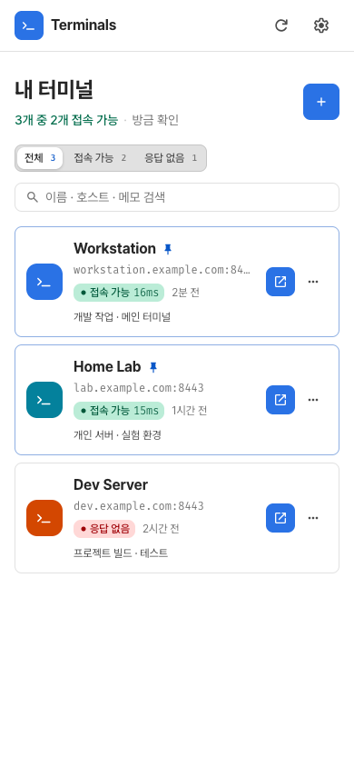
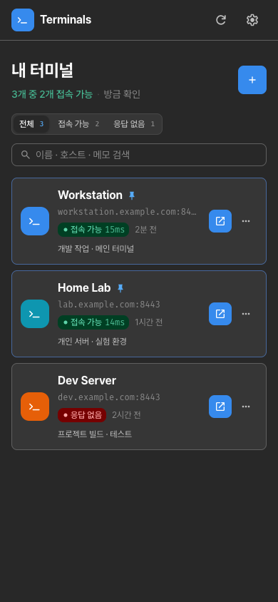

# launcher

런처는 ttyd 터미널 주소를 저장하는 정적 PWA입니다.
PWA는 브라우저에서 앱으로 설치할 수 있는 웹 앱입니다.
목록의 카드를 누르면 해당 터미널이 열립니다.

런처는 데이터를 브라우저의 `localStorage`에 저장합니다.
데이터를 저장하는 별도 서버는 없습니다.

## 화면 예시

저장한 터미널 목록과 접속 상태를 보여줍니다.
주소와 접속 상태는 문서용 예제입니다.

| 라이트 테마 | 다크 테마 |
| --- | --- |
|  |  |

## 기능

### 터미널 목록

자주 사용하는 터미널을 목록 맨 위에 고정할 수 있습니다.
나머지 터미널은 최근 접속 순서로 표시합니다.

접속 가능 여부로 목록을 필터링할 수 있습니다.
이름, 호스트, 메모로 터미널을 검색할 수 있습니다.

### 접속 상태 확인

런처는 30초마다 각 터미널 주소에 요청을 보냅니다.
목록에는 응답 여부와 응답 시간이 표시됩니다.
4초 안에 응답이 없으면 요청을 시간 초과로 처리합니다.

### 터미널 등록

다음 방법 중 하나로 터미널을 등록하세요.

- 런처에 터미널 주소를 직접 입력하세요.
- ttyd 탭에서 **공유 → Terminals**를 선택하세요.
- 다음 형식의 등록 링크를 여세요.

  ```text
  https://<런처 주소>/?add=https://host:8443/&label=Terminal
  ```

  `<런처 주소>`와 예제의 터미널 주소를 실제 주소로 바꾸세요.

### 공유와 백업

다른 기기에 터미널 주소를 공유하려면 카드 메뉴에서 등록 링크를 만드세요.

터미널 목록을 백업하려면 설정 화면에서 JSON으로 내보내세요.
저장한 목록을 복원하려면 설정 화면에서 JSON을 가져오세요.

## 화면 구성

런처는 [Vapor 디자인 시스템](https://vapor-ui.goorm.io)을 사용합니다.
React는 사용하지 않습니다.

디자인 토큰은 `@vapor-ui/core`의 공식 테마 CSS를 사용합니다.
런처는 이 CSS를 jsDelivr에서 불러옵니다.
버튼과 시트 등의 컴포넌트 스타일은 `public/vapor.css`에 일반 CSS로 정의되어 있습니다.

## 로컬 실행

Node.js와 npm이 필요합니다.
개발 서버는 Node.js 내장 모듈로 정적 파일을 제공합니다.
별도 패키지는 설치하지 않아도 됩니다.

1. 저장소의 `packages/launcher` 디렉터리로 이동하세요.

2. 개발 서버를 실행하세요.

   ```bash
   npm run dev
   ```

3. 브라우저에서 `http://127.0.0.1:8090/`을 여세요.

## 배포

다음 명령은 `packages/launcher` 디렉터리에서 실행하세요.

1. 처음 배포할 때는 Cloudflare에 로그인하세요.

   ```bash
   npx wrangler login
   ```

2. 런처를 배포하세요.

   ```bash
   npm run deploy
   ```

   이 명령은 `public` 디렉터리를 Cloudflare Pages의 `terminals-launcher` 프로젝트에 배포합니다.

## 데이터 형식

터미널 목록은 `localStorage["terminals.v1"]`에 배열로 저장합니다.
각 항목은 다음 형식을 사용합니다.

```json
{ "id": "…", "url": "https://host.tailnet.ts.net:8443/", "label": "Terminal", "note": "herdr", "color": "blue", "pinned": true, "lastUsed": 0, "createdAt": 0 }
```

## 제약

### 터미널 화면 열기

런처와 터미널은 서로 다른 오리진을 사용합니다.
오리진은 URL의 프로토콜, 호스트, 포트로 구분하는 출처입니다.

PWA에서 카드를 누르면 터미널이 커스텀 탭으로 열립니다.
런처로 돌아가려면 뒤로가기를 누르세요.

### 접속 상태의 의미

**접속 가능** 표시는 HTTP 응답을 받았다는 뜻입니다.
이 표시는 ttyd의 정상 동작을 보장하지 않습니다.

런처는 내용을 읽을 수 없는 응답인 `opaque` 응답을 기준으로 응답 시간을 측정합니다.
응답 시간은 참고 값으로 사용하세요.

### 방문 기록

런처는 다른 오리진의 방문 기록을 읽을 수 없습니다.
터미널을 등록하려면 위의 **터미널 등록** 절차를 사용하세요.
