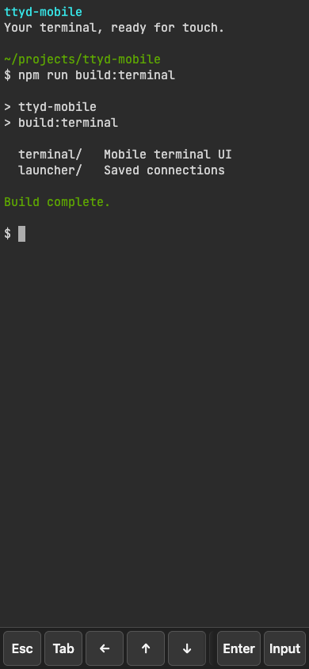
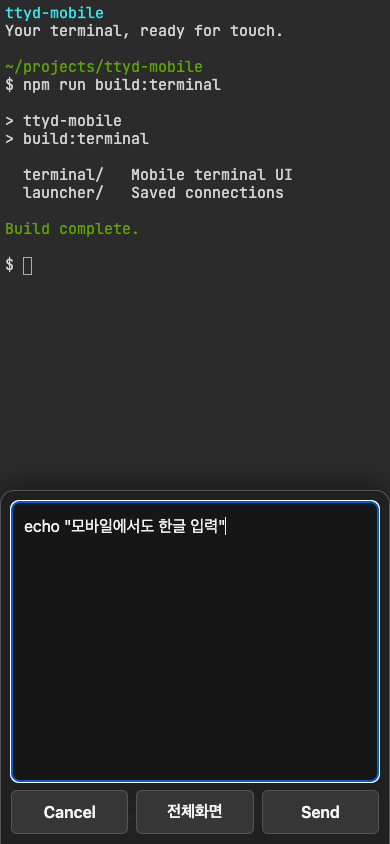

# terminal

이 패키지는 모바일 브라우저에서 원격 터미널을 사용하기 위한 ttyd용 HTML 파일입니다.
ttyd 1.7.7의 기본 HTML에 모바일용 CSS와 JavaScript를 추가했습니다.

## 화면 예시

모바일 툴바와 한글 입력 창을 보여줍니다.
터미널 출력과 입력 내용은 문서용 예제입니다.

| 터미널과 툴바 | 한글 입력 창 |
| --- | --- |
|  |  |

## 기능

### 자동 재접속

소켓 연결이 끊어지면 다시 연결합니다.
재시도 간격은 1초부터 최대 30초까지 늘어납니다.
사용자가 터미널 화면으로 돌아오면 즉시 재접속을 시도합니다.

기존의 `Press ⏎` 동작을 사용하려면 `disableReconnect=true`를 지정하세요.

### 터미널 입력

- 화면 하단의 툴바로 ESC, Tab, 방향키, Enter를 입력할 수 있습니다.
- 입력 창에서 한글이나 긴 명령을 편집할 수 있습니다. 편집한 내용은 한 번에 전송할 수 있습니다.
- **전체화면** 버튼을 누르면 입력 창이 넓어집니다.
- 화면을 위아래로 쓸면 마우스 휠 입력으로 변환하여 스크롤합니다.

### 화면 크기와 글꼴

소프트 키보드, 화면 회전, 글꼴 로딩 상태에 따라 터미널 크기를 다시 계산합니다.
화면 하단의 안전 영역을 반영합니다.
입력 중 화면이 확대되지 않도록 화면 배율 설정과 글꼴 크기를 조정합니다.

터미널은 Google Fonts의 JetBrains Mono 글꼴을 사용합니다.
처음 글꼴을 불러올 때는 다음 도메인에 연결할 수 있어야 합니다.

- `fonts.googleapis.com`
- `fonts.gstatic.com`

글꼴을 불러오지 못하면 브라우저의 기본 고정폭 글꼴을 사용합니다.

## 실행

**주의:** `-W` 옵션은 브라우저에서 터미널에 입력할 수 있게 합니다.
ttyd는 `127.0.0.1`에서만 연결을 받도록 실행하세요.
외부 기기에는 Tailscale Serve를 통해 Tailnet 내부에서만 접속을 허용하세요.
Tailscale Funnel로 터미널을 인터넷에 공개하지 마세요.

호스트는 ttyd를 실행하는 컴퓨터입니다.
다음 예제는 호스트에 ttyd, Tailscale, `herdr`가 설치되어 있다고 가정합니다.
휴대폰과 호스트는 같은 Tailscale 네트워크인 Tailnet에 연결되어 있어야 합니다.

1. 저장소의 `packages/terminal` 디렉터리로 이동하세요.

2. ttyd를 실행하세요.

   ```bash
   ttyd -i 127.0.0.1 -W -I "$PWD/ttyd-mobile.html" herdr
   ```

   다른 디렉터리에서 실행할 때는 `-I` 옵션에 HTML 파일의 절대 경로를 지정하세요.

3. 호스트의 다른 터미널에서 Tailscale Serve를 실행하세요.

   ```bash
   tailscale serve --https=8443 7681
   ```

4. 휴대폰에서 다음 주소를 여세요.

   ```text
   https://<host>.<tailnet>.ts.net:8443
   ```

   `<host>`와 `<tailnet>`을 실제 주소의 값으로 바꾸세요.

추가로 요청 출처를 검사하려면 ttyd의 `-O` 옵션을 사용하세요.

## 수정

| 파일 | 용도 |
| --- | --- |
| `mobile-enhancements.css` | 모바일 화면 스타일 |
| `mobile-enhancements.js` | 모바일 동작 |
| `ttyd-mobile.html` | ttyd가 제공하는 HTML 파일 |

1. 변경할 CSS 또는 JavaScript 원본 파일을 수정하세요.

2. `packages/terminal` 디렉터리에서 빌드 명령을 실행하세요.

   ```bash
   node build-mobile-html.mjs
   ```

   이 명령은 수정한 CSS와 JavaScript를 HTML 파일에 삽입합니다.
   저장소 루트에서는 같은 작업에 `npm run build:terminal`을 사용하세요.

## 출처와 배포

HTML은 ttyd 1.7.7이 제공하는 기본 페이지에서 추출했습니다.
글꼴은 Google Fonts의 JetBrains Mono Regular를 사용합니다.

HTML 파일을 별도로 배포할 때는 저장소 루트의 다음 파일도 함께 제공하세요.

- `LICENSE`
- `THIRD_PARTY_LICENSES.md`

## ttyd 업그레이드

1. 새 ttyd 버전의 기본 HTML을 다시 추출하세요.
2. 모바일용 변경 사항을 새 HTML에 다시 적용하세요.

기본 HTML을 교체하지 않으면 이전 버전의 xterm.js가 남습니다.
